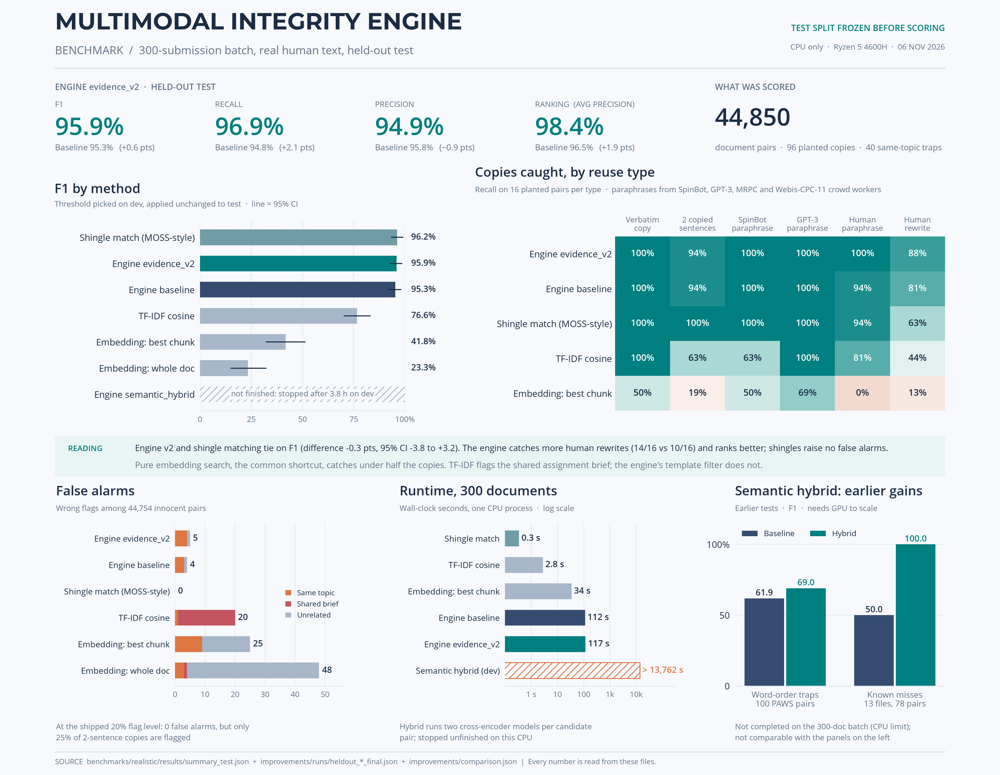
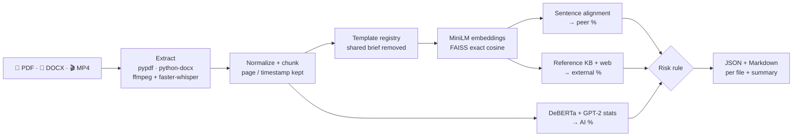
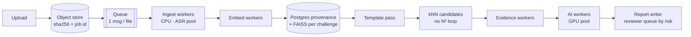

# Multimodal Submission Integrity Engine

CPU-only Python pipeline for **PDF · DOCX · MP4** submissions. For every file it writes a JSON + Markdown report with three signals, a LOW / MEDIUM / HIGH risk, and the exact evidence (passages, PDF page, video timestamp).

```bash
python run_integrity_check.py --input_dir ./sample_submissions --output_dir ./reports
```



<sub>300-submission batch, real human text, test split frozen before scoring. Details: [benchmarks/realistic](benchmarks/realistic/README.md)</sub>

---

## Results at a glance

| Check | Result |
|---|---|
| Assignment scenarios S1–S5 | ✅ 5 / 5 pass |
| Sample corpus ground-truth pairs (copy, paraphrase, MP4 ↔ PDF) | ✅ 3 / 3 found · 0 false pairs · 0 / 5 originals flagged |
| Sample corpus risk level vs manifest | 12 / 14 correct ([both misses explained](EVALUATION.md)) |
| **Realistic batch, 44,850 pairs** (engine `evidence_v2`) | **F1 95.9 %** · recall 96.9 % · precision 94.9 % |
| Same batch, best simple competitor (shingle matching) | F1 96.2 %, a statistical tie (CI −3.8 to +3.2 pts) |
| Same batch, plain embedding search | F1 23–42 % |
| 400-doc HC3 benchmark, shipped threshold | precision 0.96 · recall 0.94 · 12 template docs → score 0 |
| AI detector, HC3 held-out (105 + 105) | precision 0.99 · recall 0.99 · human FPR 1 % |
| AI detector, pre-2019 Wikipedia (human) | 0 / 30 AI_LIKELY · 11 / 30 UNSURE |
| Runtime, 14-file sample corpus | 74–87 s · 2.05–2.09 GB peak RSS · 6-core laptop CPU |
| Tests | 43 pytest tests pass |

---

## Pipeline



| Stage | What it does | Key setting |
|---|---|---|
| Ingest | Text per PDF page, DOCX in reading order, ASR segments with start/end seconds | Silent video (< −45 dB) skips ASR |
| Chunk | Whole sentences, 2-sentence overlap, exact character offsets | ≤ 200 tokens (MiniLM reads 256) |
| Template | Chunk or sentence repeated in ≥ 3 submissions = boilerplate | Discounted, still listed |
| Retrieve | FAISS `IndexFlatIP` on L2-normalised vectors | Same-document matches excluded |
| Align | Monotonic sentence alignment → evidence runs | cos ≥ 0.65, or ≥ 0.45 with token-LCS ≥ 0.60 |
| Score | Peer % = tokens in evidence runs ÷ non-template tokens | Max over sources and directions |
| AI | `0.6·classifier + 0.4·(0.75·perplexity + 0.25·burstiness)` | HUMAN < 35 ≤ UNSURE < 65 ≤ AI_LIKELY |

### Risk rule

| Level | Condition |
|---|---|
| 🔴 HIGH | peer ≥ 70 % · or peer ≥ 40 % + external ≥ 30 % · or peer ≥ 40 % + AI_LIKELY on a cross-modal pair |
| 🟠 MEDIUM | peer ≥ 20 % · or peer ≥ 10 % + external ≥ 25 % · or AI_LIKELY alone |
| 🟢 LOW | otherwise |

AI alone never produces HIGH.

<details>
<summary><b>Methodology in detail</b></summary>

- **Ingestion.** A PDF line is a header/footer only if it is first or last on ≥ 2 pages and ≥ 50 % of pages. Pages without a text layer get "no extractable text (likely scanned image)". MP4: `ffprobe` → `volumedetect` → 16 kHz WAV → whisper `tiny` int8 with VAD. Corrupt, empty, renamed `.doc` and no-audio files become `error` / `empty` / `silent_video` with a warning; the batch continues.
- **Evidence runs.** A run counts when it has ≥ 2 aligned sentences, or 1 sentence of ≥ 12 tokens at cosine ≥ 0.85 or token-LCS ≥ 0.80. Single-sentence cosine alone is unreliable: on MRPC, cosine ≥ 0.65 has a 0.67 false-positive rate.
- **Template discount** follows the winnowing "special document" idea (Schleimer et al., SIGMOD 2003), but finds the boilerplate automatically. Two students sharing text is never discounted.
- **External.** A local 6-passage KB (34 sentences, cosine ≥ 0.70) always runs. Optionally ≤ 2 DuckDuckGo queries per document (token Jaccard ≥ 0.35); network errors fall back to a mock.
- **AI detector.** Classifier `wasitaigeneratedcom/ai-text-detector-small`; perplexity/burstiness curves fitted on HC3. If a model is missing, a heuristic runs and the report says `ai_detector_source: "heuristic_fallback"`. Every UNSURE / AI_LIKELY report carries the ESL false-positive caveat (Liang et al. 2023).
- **Labels.** `verbatim` (token-LCS ≥ 0.90), `paraphrase`, `cross_modal` (one side MP4). Lexical Jaccard and LCS are shown, so a reviewer can tell a semantic match from a copy.

</details>

---

## Matching modes

| Mode | Use when | Realistic batch F1 | Cost |
|---|---|---:|---|
| `baseline` *(default)* | Standard runs | 95.3 % | 112 s / 300 docs |
| `evidence_v2` | Best measured text mode | **95.9 %** | 117 s / 300 docs |
| `semantic_hybrid` | Heavy paraphrase, cross-modal edge cases; needs a GPU at scale | not finished on CPU | > 3.8 h / 300 docs |

```bash
--config config/evidence_v2.toml                  # evidence_v2
--config improvements/configs/proposed.toml       # semantic_hybrid
```

| `semantic_hybrid`: earlier measured gains | Baseline F1 | Hybrid F1 |
|---|---:|---:|
| 100 PAWS word-order traps | 61.9 % | 69.0 % |
| 13 files with 2 known misses | 50.0 % | 100 % |

Details: [docs/improvements/MATCHING_IMPROVEMENTS.md](docs/improvements/MATCHING_IMPROVEMENTS.md).

---

## Quickstart

Linux or macOS, Python 3.11, `ffmpeg` on PATH.

```bash
bash scripts/setup_env.sh      # venv + CPU torch + requirements + models (~2.5 GB)
.venv/bin/python run_integrity_check.py --input_dir ./sample_submissions --output_dir ./reports
```

| Flag | Effect |
|---|---|
| `--eval ./sample_submissions/dataset_manifest.json` | Score against ground truth, refresh `EVALUATION.md` |
| `--skip-web` | Local KB only |
| `--models-only` | Download models and exit |
| `--generate-dataset [--seed 42]` | Rebuild the 14 sample files (byte-deterministic) |
| `--config my.toml` | Override any threshold in `config/default.toml` |
| `--matching-mode <mode>` | `baseline` · `boundary` · `semantic_sts` · `semantic_nli` · `semantic_hybrid` · `evidence_v2` |

| Exit code | Meaning |
|---|---|
| `0` | Run completed, including corrupted inputs |
| `1` | Fatal: missing input dir, no supported files, bad config, embedding model unavailable |
| `2` | Usage error |

---

## Output

```
reports/
├── per_doc/<file>.json     assignment schema + extension fields
├── per_doc/<file>.md       reviewer view: verdict, side-by-side passages
├── summary/latest.json     all verdicts + document × document matrix + timings
├── summary/SUMMARY.md      same, as a table
└── summary_metrics.json    with --eval
```

<details>
<summary><b>Example: cross-modal match (Scenario 1)</b></summary>

```json
{
  "document_id": "07_pitch_crossmodal.pdf",
  "total_integrity_risk": "HIGH",
  "scores": {"peer_similarity_percentage": 100.0, "external_similarity_percentage": 0.0,
             "ai_generated_probability": 65.1},
  "peer_matches": [],
  "multimodal_matches": [{
    "matched_file": "08_pitch_crossmodal_video.mp4",
    "similarity_score": 0.90,
    "location": {"query_page": 2, "matched_timestamp": "00:00:00 - 00:00:25"},
    "overlap_kind": "cross_modal",
    "lexical_jaccard": 0.89,
    "note": "spoken/written cross-modal match (lexical Jaccard 0.89, token-LCS 0.87; ASR noise expected)"
  }],
  "explanations": "Peer similarity: 100.0% across 1 listed source(s) ..."
}
```

The first six keys follow the assignment schema in order. Extra fields after `explanations`: `status`, `warnings`, `external_matches`, `ai_analysis`, `template_registry_hits`, `doc_pair_scores`, `provenance`.

</details>

---

## Scaling to 10,000 submissions



| Stage | Measured rate (6-core CPU) | 10k projection | GPU? |
|---|---|---|---|
| ASR, whisper-tiny int8 | real-time factor 0.07 | **17.5 box-h** (5k × 3-min videos) | optional |
| AI classifier, DeBERTa-v3-large | ~2 s / 512-token window | **22 box-h** (40k windows) | **yes, dominant cost** |
| GPT-2 statistics | 0.4 s / doc | 1.1 box-h | no |
| MiniLM embeddings | 160 sentences / s | 1.4 box-h | no |
| Sentence kNN, 750k vectors | HNSW 0.41 ms / query, recall 0.993 | minutes | no |
| Alignment + evidence | 0.27 s / doc | 45 min | no |

| | Value |
|---|---|
| Total CPU | ~43 box-hours → 1.5–2 h on 32 workers |
| Cost | ≈ **$15 per 10k challenge** (c6i.2xlarge at ~$0.34/h) |
| Vectors | 80k chunks (123 MB, Flat) + 750k sentences (1.15 GB, HNSW M=32, ef=128) |
| Storage | ~1.3 GB vectors + media |

| Bottleneck | Mitigation |
|---|---|
| AI classifier: 1.7 GB per process, RAM-bound | GPU, or a smaller in-domain detector |
| Long videos | Cap length, VAD (done), escalate low-confidence clips only |
| Template sentences flood kNN | Remove them **before** the kNN stage |
| Embedding model change invalidates vectors | Store model + version per vector; rebuild per challenge |
| Free web search rate limits (20k queries) | Paid API or offline crawl added to the KB |
| ANN recall loss = lost evidence | Keep efSearch high; spot-check against Flat |

<sub>10k figures are projections from measured per-unit rates; cloud prices are approximate list prices. Full reasoning: [EVALUATION.md](EVALUATION.md).</sub>

---

## Assumptions

| # | Assumption |
|---|---|
| A1 | **Peer %** = share of non-template tokens covered by sentence-evidence runs vs one source. The spec's chunk mean-max cosine scored pair AUC 0.637; sentence evidence scored 0.99998. |
| A2 | Self-match = same chunk, same document, or byte-identical file (reported at 1.0, counted once) |
| A3 | DOCX has no pages → `null` location. PDF = 1-based page. MP4 = `hh:mm:ss - hh:mm:ss` |
| A4 | English only; non-English audio is warned and still processed |
| A5 | Transcript chunks group ASR segments, so every chunk has exact times |
| A6 | External % uses the same token-coverage idea as peer % |
| A7 | The assignment's "cosine > 0.80" is a passage band label, not a detection gate (it catches 30 % of MRPC paraphrases) |
| A8 | Offline: no embedding model → exit 1; no Whisper → MP4 `error`; no AI models → heuristic, marked per report |
| A9 | Sample corpus = 5 PDF / 6 DOCX / 3 MP4; one silent MP4 covers Scenario 3 |
| A10 | Python 3.11; `transformers` 5.22.1 and `primp` 0.15.0 pinned for compatibility |
| A11 | Model RAM: MiniLM 90 MB · GPT-2 0.55 GB · classifier 1.7 GB · whisper-tiny 75 MB |
| A12 | Doc 06 is genuinely LLM-generated (GLM). Other synthetic docs are machine-written too, so HC3 and Wikipedia are the human ground truth for the AI detector |

<details>
<summary><b>Further notes</b></summary>

- MEDIUM peer threshold is 20 %, not the spec's 40 %: at 40 %, recall on one-third copies was 0.31.
- Burstiness has no useful signal (AUC 0.29); it stays only because the spec fixes the formula.
- Overlap is flagged on both sides of a pair; who copied whom is out of scope.
- The engine is deterministic: two runs give identical reports (`tests/test_determinism.py`).

</details>

---

## Known limitations

| Limitation | Evidence |
|---|---|
| Garbled transcripts fail silently | At WER 0.66 the cross-modal copy was invisible (failure study 1) |
| AI signal unreliable on polished business prose | Classifier ≥ 0.5 on a third of human Wikipedia intros (failure study 2) |
| Small partial copies missed at the shipped 20 % flag | 2 copied sentences in ~380 words: 25 % flagged (realistic batch) |
| Heavy paraphrase under-scored | Doc 03 detected at 62 % but below HIGH |
| Word order | MiniLM cannot tell "A acquired B" from "B acquired A" (PAWS) |
| No OCR, no cross-language matching | Scanned PDFs → `empty` |
| Web tier is a demo | Free DuckDuckGo results are noisy and rate-limited |
| `semantic_hybrid` is slow on CPU | > 3.8 h for 300 docs vs 2 min for `evidence_v2` |

---

## Repository map

| Path | Contents |
|---|---|
| `run_integrity_check.py` | CLI entry point |
| `integrity_engine/` | Ingestion, chunking, embeddings, alignment, scoring, reporting, evaluation |
| `config/` | `default.toml` (every threshold, with reasons) · `evidence_v2.toml` |
| `sample_submissions/` | 14 files + `dataset_manifest.json` ground truth |
| `reports/` | Committed reports from the final sample run |
| `benchmarks/` | Public-data benchmarks · [`realistic/`](benchmarks/realistic/README.md) batch benchmark |
| `validation/` · `improvements/` | Independent validation runs and the matching-repair experiment |
| `output/benchmark/` | Benchmark images + the scripts that draw them from result JSON |
| `tests/` | 43 tests: scenarios, corrupted inputs, core math, determinism, matching repair |

| Document | Read it for |
|---|---|
| [EVALUATION.md](EVALUATION.md) | Every measured table, failure studies, scaling numbers |
| [benchmarks/realistic/README.md](benchmarks/realistic/README.md) | The 300-submission batch benchmark |
| [docs/](docs/README.md) | Research notes, design spec, validation reports, matching improvements, history |

`python -m pytest tests -q` runs all 43 tests (~6 min; models must be cached). `ruff check integrity_engine tests benchmarks run_integrity_check.py` passes.

---

## AI-assistant disclosure

| Area | How AI was used |
|---|---|
| Research, spec, code | An agent workflow (research → spec → engineering) in Kiro / OpenCode with Claude and GLM models wrote most of the code, tests, benchmarks and docs. A human reviewed the spec and requested five changes (MP4 count, a genuine LLM document, PDF count, AI-detector honesty, de-scoping). |
| Sample data | Doc 06 was generated by GLM on purpose. Other synthetic documents were also AI-drafted (Assumption A12). |
| Numbers | Every figure comes from a script in this repository. None was written by hand or by a model without being measured. |

I am prepared to explain every design decision and line of code in a follow-up interview.
