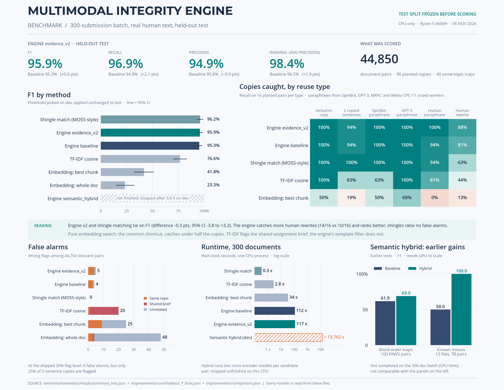

# Realistic batch benchmark

One simulated challenge batch: **300 submissions, every pair scored (44,850 pairs)**. Text is real and human-written. The reuse is real paraphrasing, made by people, a paraphrasing tool and an LLM.



## What is in a split

| Part | Count | Source |
|---|---:|---|
| Submission = 3 paragraphs (~380 words) | 300 | Wikipedia paragraphs, plus 15 % Project Gutenberg book passages |
| Verbatim copy of one paragraph | 16 pairs | — |
| Only 2 consecutive sentences copied | 16 pairs | — |
| Paraphrase by a paraphrasing tool | 16 pairs | SpinBot, [Wahle et al. 2022](https://huggingface.co/datasets/jpwahle/machine-paraphrase-dataset) |
| Paraphrase by an LLM | 16 pairs | GPT-3, [Wahle et al. 2022](https://huggingface.co/datasets/jpwahle/autoregressive-paraphrase-dataset) |
| Human sentence paraphrases | 16 pairs | MRPC (train → dev, validation → test) |
| Human rewrite of a whole passage | 16 pairs | [Webis-CPC-11](https://zenodo.org/records/3251771) crowd workers, CC BY 4.0 |
| Same-topic trap (shared names, no reuse) | 40 pairs | Wikipedia |
| Shared assignment brief | 15 docs | Sanctioned text; must **not** be flagged |

## Protocol


| Guard | How |
|---|---|
| No accidental overlap | Zero unplanted pairs share an 8-word sequence; zero shared between dev and test |
| Same rule for every method | Threshold = best F1 on dev, applied unchanged to test |
| Test scored once | `freeze.json` hashes 27 files; `run_bench.py` refuses the test split if any hash changes |
| Uncertainty | 2,000 stratified bootstrap resamples, paired across methods |
| Reproducible | Rebuilding from the fetched sources gives byte-identical `dev.json` / `test.json` |

## Test results

| Method | F1 | 95 % CI | Precision | Recall | False alarms | Time (300 docs) |
|---|---:|---|---:|---:|---:|---:|
| Shingle match (MOSS-style 5-grams) | 96.2 % | 93.3–98.9 | 100 % | 92.7 % | 0 | 0.3 s |
| **Engine `evidence_v2`** | **95.9 %** | 92.9–98.4 | 94.9 % | **96.9 %** | 5 | 117 s |
| Engine baseline | 95.3 % | 92.1–97.9 | 95.8 % | 94.8 % | 4 | 112 s |
| TF-IDF cosine | 76.6 % | 70.3–83.0 | 78.3 % | 75.0 % | 20 | 2.8 s |
| Embedding, best chunk | 41.8 % | 32.4–51.2 | 56.1 % | 33.3 % | 25 | 34 s |
| Embedding, whole doc | 23.3 % | 15.1–32.1 | 28.4 % | 19.8 % | 48 | 39 s |
| Engine `semantic_hybrid` | — | — | — | — | — | stopped after 13,762 s on dev |

Engine v2 minus shingle F1: −0.3 pts, 95 % CI −3.8 to +3.2, so it is a tie. Source: [`results/summary_test.json`](results/summary_test.json).

## What `evidence_v2` changed (chosen on dev)

| Fix | Dev problem it solved |
|---|---|
| Template text removed per sentence, not per 200-token chunk | A fully copied paragraph sharing a chunk with the brief scored 0.10 |
| Sentences > 300 chars split at `;` / `,` | GPT-3 text without full stops formed 60-word "sentences" that never aligned |
| A sentence sharing an exact 10-word run counts as evidence | GPT-3 paraphrase with merged sentences scored 0 |

| Dev sweep | F1 |
|---|---:|
| Baseline | 0.958 |
| Split at 800 / 400 / **300** / 200 chars | 0.958 / 0.969 / **0.974** / 0.969 *(earlier dev build, see `history/`)* |
| Exact-run evidence off / 2 / **3** / 5 shared 8-grams | 0.969 / 0.974 / **0.974** / 0.974 |

## Limitations

- Paraphrases were linked to their originals by shared names and numbers. That favours paraphrases that kept their names, which slightly helps lexical methods.
- The no-overlap guard means common 10-word phrases never appear across innocent pairs, so the exact-run rule's false-alarm rate on real batches is untested.
- Text only. ASR, PDF layout and AI detection are not part of this benchmark.
- The 5 engine false alarms are real paraphrase-like sentences about the same facts in different Wikipedia articles.

## Reproduce

```bash
.venv/bin/python benchmarks/realistic/fetch.py                     # ~370 MB, hash-checked
.venv/bin/python benchmarks/realistic/pair_sources.py \
  benchmarks/realistic/work/raw/machine_paraphrase_train.tsv \
  benchmarks/realistic/work/raw/autoregressive_paraphrase.tsv
# data/ is committed; build_data.py refuses to overwrite test.json
for m in shingle_moss tfidf_cosine embed_doc embed_maxchunk engine_baseline engine_v2; do
  HF_HUB_OFFLINE=1 .venv/bin/python benchmarks/realistic/run_bench.py --split test --method $m --out-dir /tmp/rb
done
```

`history/` keeps every superseded run: v1 data (no human rewrites), v2 data (non-deterministic builder, fixed), and dev sweeps. None of it was scored on test.
