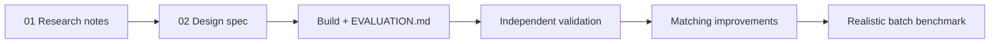

# Documentation map

| Step | Document | What it answers |
|---|---|---|
| 1 | [01_research_notes.md](01_research_notes.md) | What prior work and tools exist; why this stack |
| 2 | [02_SPEC.md](02_SPEC.md) | Full design spec, incl. the human review fixes |
| — | [03_llm_generated_sample.md](03_llm_generated_sample.md) | Provenance of the genuinely LLM-generated doc 06 |
| 3 | [../EVALUATION.md](../EVALUATION.md) | Measured results on the sample corpus and public benchmarks |
| 4 | [validation/ASSIGNMENT_VALIDATION.md](validation/ASSIGNMENT_VALIDATION.md) | Assignment requirements checked one by one |
| 4 | [validation/INDEPENDENT_EVALUATION.md](validation/INDEPENDENT_EVALUATION.md) | Results on a new, independently written corpus |
| 4 | [validation/OVERFITTING_ANALYSIS.md](validation/OVERFITTING_ANALYSIS.md) | Were the earlier benchmarks tuned to the test data? |
| 4 | [validation/VALIDATION_ISSUES.md](validation/VALIDATION_ISSUES.md) | Problems found by validation |
| 5 | [improvements/MATCHING_IMPROVEMENTS.md](improvements/MATCHING_IMPROVEMENTS.md) | `boundary` / `semantic_*` modes and their measured effect |
| 6 | [../benchmarks/realistic/README.md](../benchmarks/realistic/README.md) | 300-submission batch benchmark and `evidence_v2` |
| — | [history/next_session.md](history/next_session.md) | Build-session handoff notes (historical) |

**Moved files.** The four validation reports, `MATCHING_IMPROVEMENTS.md` and `next_session.md` used to sit in the repository root. Their relative links were updated after the move, so their SHA-256 no longer matches `improvements/prior_results_freeze.json` (which records the pre-move bytes; git history keeps them). The generator scripts now write to these new paths.
